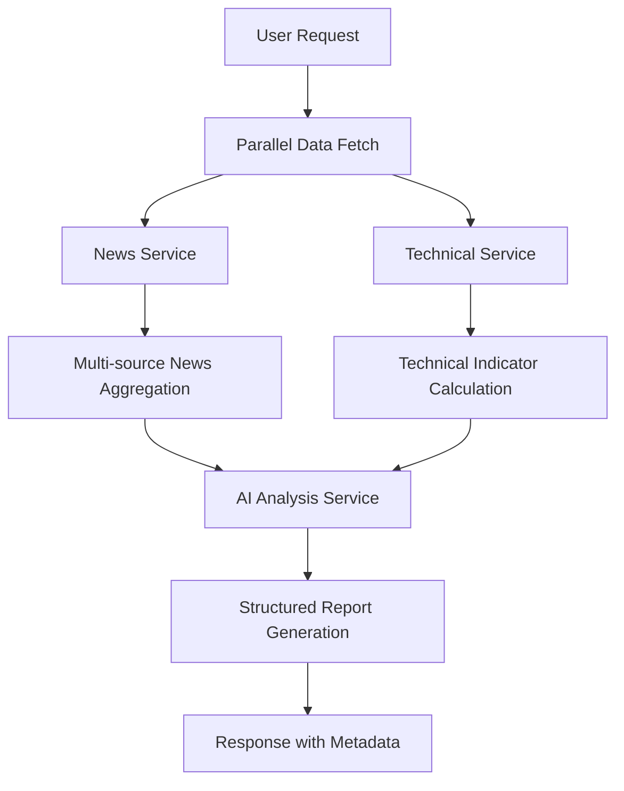

# Technical Documentation
## Market Intelligence Dashboard

---

## 1. System Overview

The Market Intelligence Dashboard is an AI-powered financial news analysis system that aggregates real-time market data from multiple sources and generates structured analytical reports. The system provides comprehensive market intelligence through automated data collection, technical analysis, and AI-driven insights.

### Core Purpose
- **Primary Function**: Generate comprehensive daily market reports combining news analysis, technical indicators, and global market data
- **Target Users**: Financial professionals, traders, investment researchers, and market analysts
- **Key Value Proposition**: Automated aggregation and intelligent analysis of disparate financial data sources into actionable insights

---

## 2. System Architecture

### High-Level Architecture

```
┌─────────────────┐    ┌─────────────────┐    ┌─────────────────┐
│   Web Client    │───▶│  Express.js     │───▶│  External APIs  │
│   (Frontend)    │    │   Server        │    │ (News, Market)  │
└─────────────────┘    └─────────────────┘    └─────────────────┘
                                │
                                ▼
                       ┌─────────────────┐
                       │   AI Services   │
                       │ (Gemini/OpenAI) │
                       └─────────────────┘
```

### Component Architecture

#### Frontend Layer
- **Technology**: Vanilla HTML5, CSS3, JavaScript ES6+
- **Architecture Pattern**: Single Page Application (SPA)
- **UI Framework**: Custom CSS with CSS Variables for theming
- **Responsive Design**: Mobile-first approach with adaptive layouts

#### Backend Layer
- **Runtime**: Node.js
- **Framework**: Express.js v5.2.1
- **Architecture Pattern**: RESTful API with service-oriented architecture
- **Route Structure**: Modular routing with centralized error handling

#### Service Layer
- **News Service**: Multi-source data aggregation with deduplication
- **AI Service**: Provider-agnostic AI analysis with fallback mechanisms
- **Technical Service**: Real-time technical indicator calculations

---

## 3. Technology Stack

### Core Technologies
| Component | Technology | Version | Purpose |
|-----------|------------|---------|---------|
| Backend Runtime | Node.js | Latest LTS | Server execution environment |
| Web Framework | Express.js | ^5.2.1 | HTTP server and API routing |
| HTTP Client | Axios | ^1.13.5 | External API communications |
| Environment Config | dotenv | ^17.3.1 | Configuration management |
| CORS Handler | cors | ^2.8.6 | Cross-origin request handling |

### External Integrations
| Service | Type | Purpose | Tier |
|---------|------|---------|------|
| Google Gemini | AI Analysis | News and data analysis | Free/Paid |
| OpenRouter | AI Analysis | Alternative AI provider | Free/Paid |
| NewsAPI.org | News Source | Primary news aggregation | Free/Paid |
| Google News RSS | News Source | Fallback news source | Free |
| Yahoo Finance API | Market Data | Real-time market prices | Free |
| NSE API | Options Data | Nifty option chain analysis | Free |

---

## 4. System Components

### 4.1 Web Server (server.js)
**Responsibilities:**
- Express.js application initialization
- Static file serving for frontend assets
- Route registration and middleware configuration
- Server lifecycle management

**Key Features:**
- CORS-enabled for cross-origin requests
- JSON request body parsing
- Static file serving from `/public` directory
- Environment-based port configuration (default: 3000)

### 4.2 API Routes (routes/report.js)
**Endpoints:**

| Method | Endpoint | Description | Response |
|--------|----------|-------------|----------|
| GET | `/api/health` | System health and configuration check | JSON status object |
| POST | `/api/generate-report` | Generate complete market analysis | JSON report with metadata |
| GET | `/api/test-news` | Preview news fetch without AI analysis | JSON news data |

**Error Handling:**
- Structured error responses with suggestions
- Performance timing metadata
- Graceful degradation for missing API keys

### 4.3 News Service (services/newsService.js)
**Data Sources:**
1. **NewsAPI.org** (Primary) - Structured financial news with metadata
2. **Google News RSS** (Fallback) - Free RSS feed parsing
3. **Market Data APIs** - Real-time price and index data

**Key Features:**
- Multi-source aggregation with source prioritization
- 24-hour time filtering for relevancy
- Title-based deduplication algorithm
- Live market data integration (indices, currencies, commodities)
- Error resilience with source fallback mechanisms

**Data Processing Pipeline:**
```
Raw News Sources → Time Filtering → Deduplication → Content Enrichment → Output
```

### 4.4 AI Service (services/aiService.js)
**AI Provider Support:**
- **Google Gemini 2.5 Flash** (Primary) - Free tier available
- **OpenRouter** (Alternative) - Multiple model options including free tiers

**Analysis Capabilities:**
- Multi-source data synthesis
- Financial event extraction and categorization
- Impact assessment and verification status
- Historical context and comparison
- Market sentiment analysis

**Prompt Engineering:**
- YouTube-style conversational tone for accessibility
- Structured JSON response format
- Real-time data integration
- Risk and opportunity identification

### 4.5 Technical Analysis Service (services/technicalService.js)
**Calculated Indicators:**
- **Trend Indicators**: SMA (5,10,20,50,200), EMA (9,21)
- **Momentum Indicators**: RSI (14), Stochastic RSI, MACD (12,26,9)
- **Volatility Indicators**: Bollinger Bands (20,2), ATR (14)
- **Support/Resistance**: Pivot Points (Classic), Option Chain OI Analysis

**Data Sources:**
- Yahoo Finance for historical OHLCV data
- NSE for real-time option chain data
- 3-month historical data for indicator calculations

**Real-time Processing:**
- Live price feed integration
- Intraday technical signal generation
- Option chain Put-Call Ratio (PCR) analysis
- Maximum Open Interest level identification

---

## 5. Data Flow Architecture

### 5.1 Report Generation Workflow



### 5.2 Data Processing Pipeline

#### Input Sources
1. **News Data**: Title, description, source, publication time, category
2. **Market Data**: OHLCV prices, volume, indices, currencies
3. **Technical Data**: Historical price arrays, option chain OI data

#### Processing Steps
1. **Data Collection**: Parallel fetch from multiple sources
2. **Data Validation**: Time filtering, format validation, error handling
3. **Data Enrichment**: Technical indicator calculations, sentiment scoring
4. **AI Analysis**: Structured analysis with prompt engineering
5. **Output Generation**: JSON response with metadata and performance metrics

#### Output Structure
```json
{
  "report": {
    "events": [...],
    "overallMarketSummary": {...},
    "globalMarketSnapshot": {...}
  },
  "technicalData": {...},
  "meta": {
    "articlesAnalyzed": 45,
    "eventsIdentified": 8,
    "generationTime": "12.3s"
  }
}
```

---

## 6. API Specifications

### 6.1 Report Generation API

**Endpoint**: `POST /api/generate-report`

**Request**: Empty body (all configuration via environment variables)

**Response Format**:
```json
{
  "success": true,
  "report": {
    "reportTitle": "Market Report - [Date]",
    "generatedAt": "2026-02-24T10:30:00.000Z",
    "events": [
      {
        "eventNumber": 1,
        "title": "Event title",
        "detailedSummary": "Analysis text",
        "historicalComparison": "Context",
        "verificationStatus": "Confirmed|Official Source|Market Rumor|Assumption",
        "expectedImpact": "Positive|Negative|Neutral",
        "impactSeverity": "Low|Moderate|High",
        "estimatedImpactPercent": "0.5-1.0%",
        "affectedMarkets": ["Nifty 50", "Bank Nifty"],
        "sourceReliability": "High|Medium|Low",
        "category": "Category",
        "newsDate": "DD MMM YYYY, HH:MM AM/PM"
      }
    ],
    "overallMarketSummary": {
      "intradayOutlook": "Market outlook text",
      "sentimentIndicator": "Bullish|Neutral|Bearish",
      "nifty50Analysis": {
        "currentPrice": 25750.30,
        "supportLevels": [25500, 25300],
        "resistanceLevels": [25900, 26000],
        "trend": "Uptrend|Downtrend|Sideways",
        "momentum": "Strong|Moderate|Weak",
        "volatilityExpectation": "Low|Moderate|High",
        "rsi": 65.5,
        "rsiSignal": "Signal description",
        "macdSignal": "MACD analysis",
        "movingAverages": "MA analysis",
        "bollingerBandPosition": "Band position",
        "pivotPoint": 25725.50,
        "atr": 125.75
      }
    }
  },
  "technicalData": {...},
  "meta": {...}
}
```

**Error Response**:
```json
{
  "success": false,
  "error": "Error message",
  "suggestion": "Actionable suggestion",
  "meta": {
    "generationTime": "2.1s"
  }
}
```

### 6.2 Health Check API

**Endpoint**: `GET /api/health`

**Response**:
```json
{
  "status": "ok",
  "provider": "gemini",
  "hasNewsApiKey": true,
  "hasAiKey": true
}
```

---

## 7. Security & Authentication

### Current Implementation
- **API Key Management**: Server-side environment variable storage
- **CORS Configuration**: Enabled for cross-origin requests
- **Input Validation**: Basic request validation and sanitization
- **Error Handling**: Structured error responses without sensitive data exposure

### Security Considerations
- API keys never exposed to client-side code
- Rate limiting handled by external API providers
- No user authentication (read-only public dashboard)
- Environment variable protection for sensitive configuration

---

## 8. Performance & Scalability

### Performance Characteristics
- **Response Time**: 8-15 seconds for complete report generation
- **Concurrent Requests**: Limited by external API rate limits
- **Memory Usage**: Minimal state maintenance (stateless design)
- **CPU Usage**: Primarily I/O bound with minimal computation

### Scalability Considerations
- **Horizontal Scaling**: Stateless design supports load balancing
- **Rate Limiting**: Dependent on external API quotas
- **Caching**: No current caching layer (real-time data priority)
- **Database**: No persistent storage requirements

### Optimization Opportunities
1. **Response Caching**: Cache reports for short durations (5-10 minutes)
2. **Connection Pooling**: Implement HTTP connection reuse
3. **Parallel Processing**: Already implemented for data fetching
4. **CDN Integration**: Static asset delivery optimization

---

## 9. Deployment Architecture

### Development Environment
- **Local Development**: Node.js with file watching
- **Configuration**: Environment variables via `.env` file
- **Dependencies**: NPM package management

### Production Considerations
- **Environment Variables**: Secure configuration management
- **Process Management**: PM2 or similar process managers
- **Reverse Proxy**: Nginx or similar for static file serving
- **SSL Termination**: HTTPS implementation at proxy level

### Infrastructure Requirements
- **Compute**: Minimal CPU requirements (I/O bound)
- **Memory**: 256MB-512MB typical usage
- **Network**: Reliable internet for external API calls
- **Storage**: Minimal (no persistent data storage)

---

## 10. Monitoring & Observability

### Current Logging
- **Console Logging**: Structured request/response logging
- **Error Tracking**: Error messages with context
- **Performance Metrics**: Response time measurement
- **API Status**: Health endpoint for system monitoring

### Recommended Enhancements
1. **Application Monitoring**: APM tool integration
2. **Log Aggregation**: Centralized logging system
3. **Metrics Collection**: Business and technical metrics
4. **Alerting**: Automated failure notifications
5. **Health Checks**: Comprehensive system health monitoring

---

## 11. Integration Points

### External Dependencies
| Service | Dependency Level | Failure Impact | Mitigation |
|---------|------------------|----------------|------------|
| AI Providers | Critical | Report generation fails | Multi-provider support |
| News APIs | High | Reduced data quality | Multiple source fallback |
| Market Data APIs | Medium | Missing technical data | Graceful degradation |
| Yahoo Finance | Low | Reduced market context | Alternative data sources |

### API Rate Limits
- **Google Gemini**: Free tier limits apply
- **NewsAPI**: 1000 requests/day (free tier)
- **OpenRouter**: Model-specific limits
- **Yahoo Finance**: No documented limits (unofficial API)

### Data Freshness
- **News Data**: Real-time to 15-minute delay
- **Market Data**: Real-time during market hours
- **Technical Indicators**: Based on latest available price data
- **AI Analysis**: Generated on-demand (no caching)

---

This technical documentation provides a comprehensive overview of the Market Intelligence Dashboard system architecture, designed for technical stakeholders who need to understand, maintain, or extend the system.